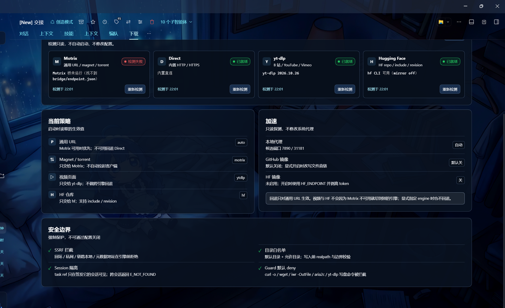

<p align="center">
  
</p>

<h1 align="center">dsh-download-nexus</h1>

<p align="center">
  <strong>统一下载入口：Motrix · 直连 · yt-dlp · Hugging Face</strong><br/>
  <sub>给 DeepSeek Harness 的一个下载插件：一个 <code>download</code> 工具按目标自动选引擎，agent 想用 <code>curl&nbsp;-o</code> 偷偷写盘时把它拦下来。</sub>
</p>

<p align="center">
  
  
  
  
  
</p>

<p align="center">
  <a href="#安装">安装</a> ·
  <a href="#它能做什么">它能做什么</a> ·
  <a href="#四个引擎">四个引擎</a> ·
  <a href="#工具">工具</a> ·
  <a href="#配置">配置</a> ·
  <a href="#安全边界">安全边界</a> ·
  <a href="#文档">文档</a>
</p>

<p align="center">
  
</p>

---

## 安装

```bash
git clone https://github.com/zeki520/dsh-download-nexus.git
cd dsh-download-nexus
npm test
npm pack --pack-destination "C:/Users/<你的用户名>/dsh-plugins"
```

在 DSH 会话里装上刚打出来的 tarball：

```text
plugin_manager action=install_bundle target=C:\Users\<你的用户名>\dsh-plugins\dsh-download-nexus-0.6.11.tgz
```

装完重启 DSH：配置页在插件详情里，会话里多一个「下载」页签。默认 `toolPrefix` 为空，工具名就是 `download` / `download_status` / `download_control` / `download_doctor` / `motrix_provision`。

> 发行包已附在本仓库的 Releases，可以直接下载 `dsh-download-nexus-0.6.11.tgz`，跳过打包步骤。

## 它能做什么

DSH 原先没有统一的下载工具，agent 常直接 `curl -o` / `wget -O` / `Invoke-WebRequest -OutFile`：拿不到多连接加速，也没有进度、断点、归属与清理。这个插件做三件事：

1. **一个入口**：`download` 按目标类型自动选引擎，你只给 URL 和保存目录。
2. **真正用上本机加速器**：普通文件走 Motrix（MDXP 多连接 + 代理），视频走 yt-dlp，HF 仓库走 `hf` CLI，`magnet` / `.torrent` 交给 Motrix。
3. **拦住写盘下载**：`tools/pre-execute` 默认 deny 掉用 shell 写文件的下载命令，把 agent 引到 `download`；只读探测（`curl -I`、`--spider`、`yt-dlp --skip-download`）照常放行。

每个下载任务都有 `task_ref`，可以查进度、暂停、恢复、取消、清理，且**只在发起它的会话里可见**。

## 四个引擎

| 目标 | 引擎 | 行为 |
| --- | --- | --- |
| 普通 URL / 文件直链 | **Motrix** → 回退 **Direct** | Motrix 可用时优先（多连接 + 代理）；不可用才回退内置直连 |
| `magnet:` / `.torrent` | **Motrix** | 只交给 Motrix，不自动拉起客户端 |
| 视频页面（B 站 / YouTube / Vimeo …） | **yt-dlp** | 只交给 yt-dlp，不做跨引擎回退 |
| Hugging Face 仓库 | **hf CLI** | 支持 `repo_type` / `revision` / `include` |

回退只对普通 URL 生效。视频与 HF 不会因为 Motrix 不可用就切到别的引擎；显式指定 `engine` 时也不回退 —— 这是刻意的：下错东西比失败更麻烦。

## 工具

| 工具 | 用途 |
| --- | --- |
| `download` | 发起下载。`url` + `save_dir` 必填，其余按需（`engine`、`filename`、`headers`、`quality`、`include`、`cookies_from_browser` …） |
| `download_status` | 查单个任务详情（可等待），或列出本会话全部任务 |
| `download_control` | `pause` / `resume` / `cancel` / `purge`（`purge` 要 `confirm: true`，会删文件） |
| `download_doctor` | 诊断引擎可用性、本地代理、Motrix 端点、镜像配置；也能只读探测某个 URL 是否被 SSRF 策略放行 |
| `motrix_provision` | 只读检测 / 启动已装的 Motrix。`install` 需用户亲口确认后才执行，不绕过 SmartScreen 与 UAC |

## 配置

配置写在宿主插件的 `cordis.patch.yml` 里，**保存后重启 DSH 生效**。也可以直接在「下载」页签的配置中心里改（顶部保存 + 滚动时底部悬浮条，同一份草稿）。

| 键 | 默认 | 说明 |
| --- | --- | --- |
| `toolPrefix` | `''` | 工具名前缀。空 = `download`，设成 `conductor_` 可与旧插件共存 |
| `defaultSaveDir` | `<主目录>/Downloads` | 默认落盘目录 |
| `allowedRoots` | `[<主目录>/Downloads]` | 允许写入的根目录白名单；默认目录始终包含且不可删 |
| `connections` | `16` | Motrix 连接数（1–16） |
| `maxBytes` | `21474836480` | 单文件上限，默认 20 GiB |
| `requestTimeoutMs` | `60000` | 单次请求超时 |
| `pollMs` | `500` | 进度轮询间隔 |
| `maxWaitSeconds` | `3600` | `download_status(wait)` 最长等待 |
| `proxyCandidates` | `[7890, 31181]` | 本机代理候选端口，只连回环地址 |
| `hfMirror` / `useHfMirror` | `https://hf-mirror.com` / `false` | HF 镜像；启用时注入 `HF_ENDPOINT` 并剥离 token |
| `githubMirrorBase` / `githubMirrorDefault` | `https://ghfast.top/` / `false` | GitHub 直链镜像；显式 opt-in |
| `ytdlpPath` / `hfPath` | `yt-dlp` / `hf` | 可执行文件路径，留空即用 PATH |
| `allowShell` | `false` | 逃生舱：放行 shell 写盘下载（环境变量 `DSH_DOWNLOAD_ALLOW_SHELL=1` 可强制开启） |
| `allowExecutable` | `false` | 允许下载可执行扩展名 |
| `allowBrowserCookies` | `false` | 允许读浏览器 cookies（仅视频站） |
| `guardFailClosed` | `true` | 守卫评估异常时拒绝可疑下载命令 |

## 安全边界

这些保护由 Host 代码强制执行，配置页不提供关闭开关：

- **SSRF 拦截**：回环 / 私网 / 链路本地 / 云元数据地址在引擎前拒绝；重定向逐跳重新过策略；跨域重定向剥掉敏感头。代理 fake-ip 例外仅限本机代理。
- **目录白名单**：写入前做 `realpath` + 边界校验，`..` 与符号链接逃逸都会被消掉；默认目录自动加入白名单。
- **Session 隔离**：`task_ref` 只在发起它的会话可见，跨会话查询返回 `E_NOT_FOUND`。
- **Guard 默认 deny**：`curl -o` / `wget` / `iwr -OutFile` / `aria2c` / `yt-dlp` 写盘命令、`bitsadmin` / `certutil -urlcache` / `mshta` / `python -c` / `node -e` 内联下载，一律拦下。
- **资源限制**：并发、单文件大小、等待时长都有上限，超限任务会被 watchdog 清理。

## 文档

- [CHANGELOG.md](CHANGELOG.md) — 每个版本改了什么、为什么
- [docs/ui/](docs/ui/) — 视觉验收清单与对比度回归报告

## 开发

```bash
npm test                          # 208 例：单元 + 结构守卫 + 渲染烟测 + 对比度审计
node scripts/contrast-audit.mjs   # 只跑配色对比度（WCAG 2.1，深/浅壁纸各算一次）
```

客户端是手写的单文件 React（`lib/client.js`，走 `window.__ModuleLoader__.load`），样式内联在同一个具名模板字符串里；改样式不用重启 DSH（`ensureStyle` 会比对内容后重插），改逻辑要重装 tarball。

## License

MIT
